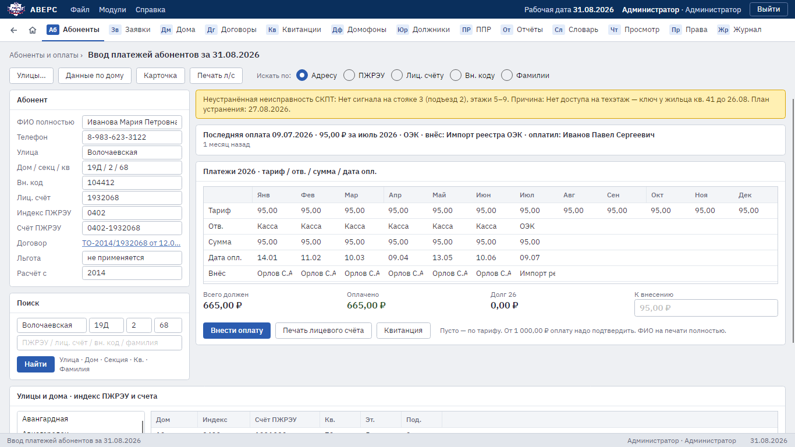

# Аверс 2.0

Система учёта антенной службы Омска: абоненты и оплаты, заявки аварийно-диспетчерской службы, паспорта домов
и схемы СКПТ, работа юристов с должниками, отчёты и выгрузка для 1С.

«Аверс 2.0» заменяет прежний «Аверс» (Delphi 6 + BDE, отдельные Java-модули, Oracle 10.2): вместо нескольких
программ — одно рабочее место, общая база PostgreSQL на сервере предприятия и страница для телефона
радиомеханика.



## Возможности

- **Абоненты и оплаты.** Поиск по адресу, фамилии, лицевому счёту и счёту ПЖРЭУ; оплаты по месяцам;
  карточка квартиры; договоры; льготы; подсветка давно не плативших; загрузка файлов ОЭК.
- **Заявки АДС.** Приём заявок от жильцов, журнал с отбором по периоду и дому, наряд-заказы, домофоны.
- **Дома.** Паспорта домов, обслуживающие организации, неустранённые неисправности, схемы СКПТ, графики ППР.
- **Юристы.** Список должников, досудебные уведомления, пакет документов для суда, заявления на судебный приказ
  и в ОСП, судебные дела, калькулятор сроков с учётом праздников.
- **Отчёты.** Итоги по заявкам и должникам в Excel, отгрузка и поступления за месяц для 1С.
- **Администрирование.** Сотрудники и роли, журнал изменений, журнал просмотров персональных данных.
- **Телефон радиомеханика.** Страница `/m/` в браузере: сведения о доме, телефоны, схемы. Только просмотр.

Подробно — в [руководстве пользователя](docs/user-guide/README.md).

## Как устроено

```text
 Рабочее место (Windows 10/11, Linux)  ─┐
 Старые ПК с Windows 7 и 8 → xrdp       ─┼─►  Сервер Аверса (ASP.NET Core)  ─►  PostgreSQL
 Телефон радиомеханика (браузер, /m/)   ─┘
```

Модульный монолит: один сервер приложений и одна база. Права доступа проверяет сервер, рабочее место только
прячет недоступные кнопки. Без сервера программа запускается в учебном режиме со своей базой SQLite
и вымышленными данными.

| Часть | Технологии |
|---|---|
| Рабочее место | .NET 10, Avalonia 12 |
| Сервер | ASP.NET Core 10, вход по токену, роли |
| База | PostgreSQL 18, EF Core 10 с миграциями; SQLite в учебном режиме |
| Документы | PDF (SkiaSharp), Excel (ClosedXML), Word |
| Windows 7 и 8 | Ubuntu Server 24.04 + xrdp |
| Сборка | GitHub Actions: сборка, тесты, форматирование, сборки для Windows и Linux |

Подробнее — [архитектура](docs/03-architecture.md) и [архитектурные решения](docs/adr/).

## Быстрый запуск

Нужен [.NET 10 SDK](https://dotnet.microsoft.com/download/dotnet/10.0).

- **«Запустить Аверс.bat»** (в Linux — `Запустить Аверс.sh`) — рабочее место с учебной базой, пароль у всех
  учебных пользователей `avers`.
- **«Запустить сервер Аверса.bat»** — сервер на `http://localhost:5115` и рабочее место, подключённое к нему;
  страница для телефона — `http://<IP компьютера>:5115/m/`.

Пошагово — в [инструкции по запуску](docs/getting-started.md). Установка в офисе — в
[инструкции по серверу](docs/09-server.md).

Для разработки:

```sh
dotnet build Avers.sln
dotnet test Avers.sln
```

## Документация

| Кому | Что читать |
|---|---|
| Сотрудникам | [Руководство пользователя](docs/user-guide/README.md) |
| Администратору | [Сервер Аверса](docs/09-server.md), [терминальный сервер для Windows 7 и 8](docs/08-terminal-server.md) |
| Разработчику | [Разработка](docs/development.md), [архитектура](docs/03-architecture.md), [ADR](docs/adr/) |
| Руководителю | [Дорожная карта](docs/05-roadmap.md), [история изменений](CHANGELOG.md) |
| Инженеру БД | [План переноса базы](docs/04-db-migration-plan.md) |

Все документы — в [оглавлении](docs/README.md).

## Состояние

Программа работает с учебной базой; сервер и рабочие места готовы к установке в офисе. Перенос настоящих
данных из Oracle ждёт выгрузки схемы JACK, обмен с 1С — ответов бухгалтерии. Что сделано и что осталось —
в [дорожной карте](docs/05-roadmap.md).
