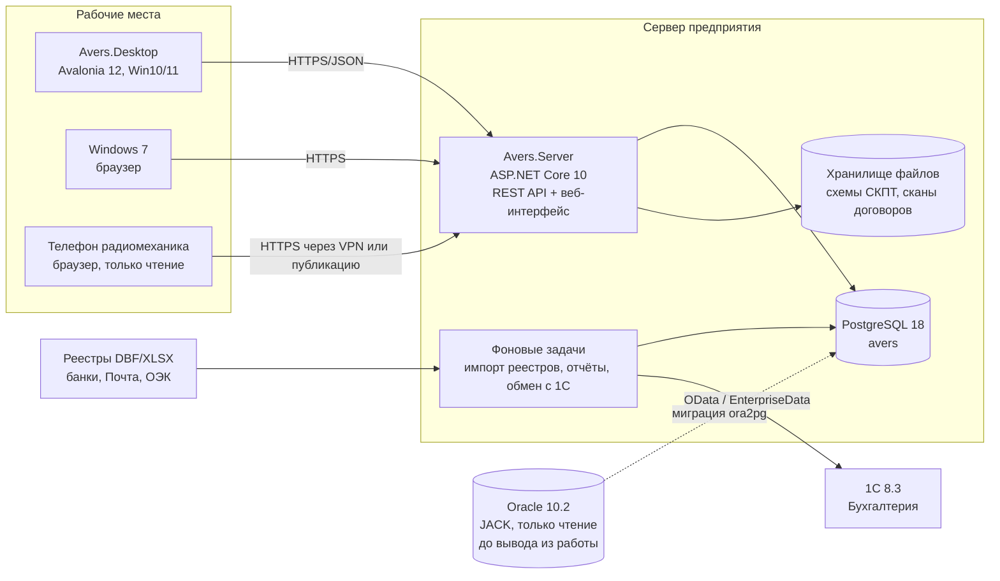

# 03. Целевая архитектура

Статус: предложено, 14.10.2026. Решения с обоснованием — в `docs/adr/`.

## Коротко

Модульный монолит на .NET 10 LTS: один сервер приложений (ASP.NET Core) с одной базой PostgreSQL,
к нему подключаются настольное приложение Avalonia 12 на рабочих местах Windows 10/11 и веб-интерфейс
(для телефонов радиомехаников и машин с Windows 7). Обмен с 1С и загрузка банковских реестров живут на сервере.



## Слои и проекты

```
src/
  Avers.Domain/          сущности и правила: абонент, отвод, дом, заявка, платёж, договор, тариф, долг
  Avers.Application/     сценарии (принять заявку, внести оплату, сформировать отгрузку), интерфейсы
  Avers.Infrastructure/  EF Core + Npgsql, файлы, DBF-импорт, XLSX/PDF, клиент 1С
  Avers.Server/          ASP.NET Core: REST API, аутентификация, роли, веб-страницы для чтения, фоновые задачи
  Avers.Contracts/       DTO и клиент API, общий для сервера и Desktop
  Avers.Desktop/         Avalonia 12, MVVM (CommunityToolkit.Mvvm), только UI и вызовы API
tests/
  Avers.Domain.Tests/  Avers.Application.Tests/  Avers.Server.IntegrationTests/ (Testcontainers + PostgreSQL)
```

Текущая оболочка (Desktop / Domain / Data на SQLite) ложится на эту схему: `Avers.Domain` переносится почти как есть,
`Avers.Data` делится на `Infrastructure` (PostgreSQL) и учебный режим, экраны `Avers.Desktop` переходят с прямого
доступа к БД на вызовы API.

## Ключевые решения

| ADR | Решение |
|---|---|
| [0001](adr/0001-record-architecture-decisions.md) | Решения фиксируем в ADR |
| [0002](adr/0002-target-database-postgresql.md) | Целевая СУБД — PostgreSQL |
| [0003](adr/0003-client-server-architecture.md) | Клиент-сервер: сервер приложений + настольный клиент + веб-интерфейс |
| [0004](adr/0004-dotnet-10-avalonia-12.md) | Перевод оболочки на .NET 10 LTS и Avalonia 12 |
| [0005](adr/0005-migration-approach.md) | Миграция: выгрузка JACK → промежуточная схема → преобразование → сверка, параллельная работа |
| [0006](adr/0006-1c-integration.md) | Обмен с 1С: Аверс — источник начислений и оплат, 1С получает сводные документы |
| [0007](adr/0007-reports-xlsx-pdf.md) | Отчёты: XLSX (ClosedXML) и PDF |

## Сквозные вопросы

- **Аутентификация.** Учётные записи в БД Аверса (ASP.NET Core Identity), пароли — хеш; позже при наличии
  Active Directory — вход по доменной учётке. Desktop получает токен и ходит в API.
- **Права.** Роли + отдельные разрешения (`subscriber.account.edit`, `house.scheme.edit`, `payments.create` …).
  Проверка на сервере в каждом обработчике; клиент лишь скрывает кнопки.
- **Аудит.** Таблица `audit_log`: кто, когда, сущность, старое/новое значение. Нужна для денег и для 152-ФЗ.
- **Схемы СКПТ.** Файлы в хранилище на сервере, метаданные в БД. Для Читателя — отдача изображения в
  браузер с водяным знаком и без кнопки «Скачать» (полностью запретить сохранение экрана невозможно — это стоит сказать заказчику).
- **Отчёты.** Генерация на сервере в фоне, результат — файл XLSX/PDF. Конструктор: набор метрик в справочнике,
  пользователь отмечает нужные.
- **Импорт реестров.** Перенос логики ImportPay (35 форматов DBF) в `Infrastructure` с описанием формата каждого
  реестра в конфигурации; логика `JACK.IMPORTPAYFROMBUFF` — в C# после разбора PL/SQL.
- **Развёртывание.** Сервер — Windows Server или Linux на сервере предприятия, PostgreSQL рядом. Desktop —
  самодостаточная сборка win-x64 с автообновлением (Velopack). Резервные копии — `pg_dump` ежедневно + WAL-архив.
- **Наблюдаемость.** Serilog в файл и в БД, health-check сервера, OpenTelemetry по желанию.

## Технологии

| Слой | Выбор | Почему |
|---|---|---|
| Платформа | .NET 10 LTS (поддержка до 14.11.2028) | .NET 8 снимается с поддержки 10.11.2026 |
| Настольный UI | Avalonia 12 | Оболочка уже на Avalonia; 12-я версия нацелена на .NET 10 |
| MVVM | CommunityToolkit.Mvvm | Простая, генераторы кода, без магии |
| Сервер | ASP.NET Core 10, Minimal API + Razor Pages/Blazor SSR для веб-чтения | Одна платформа с клиентом |
| ORM | EF Core 10 + Npgsql | Стандарт для .NET и PostgreSQL |
| СУБД | PostgreSQL 18 | Бесплатно, уже есть на предприятии (база SMS) |
| Миграция | Ora2Pg 25 (+ oracle_fdw при необходимости) | Зрелый инструмент Oracle → PostgreSQL |
| XLSX / PDF | ClosedXML / QuestPDF или PDFsharp-MigraDoc | См. ADR-0007 |
| DBF | DbfDataReader | Чтение реестров банков |
| Тесты | xUnit, Testcontainers, Verify | Интеграционные тесты на настоящем PostgreSQL |
| Обновления клиента | Velopack | Автообновление настольного приложения |
| CI | GitHub Actions (сборка, тесты, публикация) | После подключения репозитория к GitHub |
