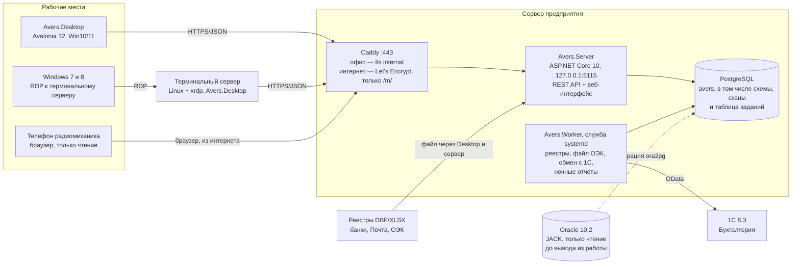

# 03. Архитектура

Статус: действует, сверено с кодом 06.11.2026. Решения с обоснованием — в `docs/adr/`. Решения архитектурного ревью
06.11.2026 (ADR-0010…0016) приняты, но в коде сделаны ещё не везде — см. «Код и решения: расхождения». Что ещё
не сделано — в разделе «Дальше».

## Коротко

Модульный монолит на .NET 10 LTS: один сервер приложений (ASP.NET Core) с одной базой PostgreSQL,
к нему подключаются настольное приложение Avalonia 12 на рабочих местах Windows 10/11 и веб-интерфейс
для телефонов радиомехаников. Машины с Windows 7 и 8 работают с тем же настольным приложением через
терминальный сервер Linux с xrdp (ADR-0008). Загрузка реестров, обмен с 1С и ночные отчёты — в фоновой службе
`Avers.Worker` рядом с сервером: та же база и тот же `Avers.Data`, отдельный процесс (ADR-0016).



## Слои и проекты

```
src/
  Avers.Domain/      сущности и правила без базы: абонент, дом, оплата, долг (Billing), заявка, роли, календарь сроков
  Avers.Data/        EF Core (PostgreSQL на сервере, SQLite в учебном режиме), миграции, учебные данные
                     и операции записи с журналом изменений: оплата, договор, тарифы, заявки, ППР, словарь…
  Avers.Contracts/   DTO API, общие для сервера и Desktop
  Avers.Server/      ASP.NET Core 10, Minimal API: вход, права, обработчики по разделам, страница /m/ для телефонов
  Avers.Desktop/     Avalonia 12, MVVM (CommunityToolkit.Mvvm); печать PDF/Word и выгрузки Excel делает сам
  Avers.Worker/      будет (ADR-0016): фоновая служба, берёт задания из таблицы в базе и вызывает операции Avers.Data
tests/
  Avers.Domain.Tests/  Avers.Data.Tests/  Avers.Server.Tests/  Avers.Desktop.Tests/ (Avalonia.Headless)
```

Зависимости идут в одну сторону: `Domain` ← `Data` ← `Server`, `Worker` и `Desktop`; `Contracts` знают только сервер и Desktop.
Операция записи пишется один раз в `Avers.Data` и вызывается и обработчиком сервера, и учебной базой Desktop;
сервер добавляет к ней проверку входных данных и прав. Отдельные слои `Application` и `Infrastructure`
не заводим, пока хватает этого.

`Avers.Desktop` работает через `IAversStore`: `ServerStore` ходит в API сервера (общая база PostgreSQL),
`LocalStore` — в свою учебную SQLite, когда адрес сервера не задан. После входа и после каждой записи программа
получает снимок справочников (`GET /api/desktop/snapshot`: улицы, дома, ППР, радиомеханики, материалы, домофоны — только то, что положено роли).
Абонентов со счетами в снимке нет, они грузятся частями: абоненты дома с оплатами — при выборе дома
(`GET /api/houses/{id}/subscribers`), поиск выполняет сервер (`GET /api/subscribers`), должников и долг по домам
сервер считает по всей базе (`GET /api/debts`, при открытии юристов и отчётов), итоги месяца для 1С —
`GET /api/reports/accounting`. На тестовой базе в 45 000 абонентов и 1,6 млн оплат вход занимает около секунды
вместо 13, программа держит в памяти около 100 МБ вместо 1,1 ГБ. Заявок в снимке тоже нет (ADR-0015): журнал
приходит по отбору экрана (`GET /api/tickets`, не больше 1000 строк, свежие сверху), помесячную сводку, годы журнала
и счёт по домам для отчётов считает база (`/api/tickets/by-month`, `/years`, `/by-house`). Из абонента в строке
журнала — только ФИО и лицевой счёт; договор, последнюю оплату и примечание открытой заявки программа запрашивает
отдельно (`/api/tickets/{id}/apartment`, просмотр записывается в журнал доступа). После записи заявки перечитываются
только заявки на экранах, снимок справочников не трогается.

Модели представления Desktop: `MainViewModel` — оболочка (вход, меню, снимок справочников, выбранные улица, дом
и квартира, карточка абонента, оплаты, печать). У остальных экранов своя модель (`TicketsViewModel`,
`ContractsViewModel`, `LegalViewModel`, `ReceiptsViewModel`, `ReportsViewModel`, `PprViewModel` и т. д.): она получает
оболочку в конструкторе, а в разметке общее берёт через `Shell.*`. Новый экран делается так же.

## Ключевые решения

| ADR | Решение |
|---|---|
| [0001](adr/0001-record-architecture-decisions.md) | Решения фиксируем в ADR |
| [0002](adr/0002-target-database-postgresql.md) | Целевая СУБД — PostgreSQL |
| [0003](adr/0003-client-server-architecture.md) | Клиент-сервер: сервер приложений + настольный клиент + веб-интерфейс |
| [0004](adr/0004-dotnet-10-avalonia-12.md) | Перевод оболочки на .NET 10 LTS и Avalonia 12 |
| [0005](adr/0005-migration-approach.md) | Миграция: выгрузка JACK → промежуточная схема → преобразование → сверка, параллельная работа |
| [0006](adr/0006-1c-integration.md) | Обмен с 1С: Аверс — источник начислений и оплат, 1С получает сводные документы |
| [0007](adr/0007-reports-xlsx-pdf.md) | Отчёты: XLSX (ClosedXML) и PDF |
| [0008](adr/0008-windows7-terminal-server.md) | Windows 7 и 8 — через терминальный сервер Linux с xrdp |
| [0009](adr/0009-scheme-images-in-database.md) | Картинки схем СКПТ хранятся в PostgreSQL |
| [0010](adr/0010-accruals-and-payments.md) | Начисление и платёж — отдельные записи, много платежей на месяц, отмена пометкой, знаковое сальдо |
| [0011](adr/0011-concurrent-edits.md) | Одновременная правка: столбец `Version`, при конфликте 409; деньги — атомарно с блокировкой |
| [0012](adr/0012-office-https-and-first-install.md) | HTTPS и в офисе (Caddy `tls internal`), Kestrel только 127.0.0.1, первый администратор командой, без учебных данных на сервере |
| [0013](adr/0013-backups-and-restore-check.md) | Резервные копии: ночной `pg_dump`, копия перед обновлением и на другой компьютер, еженедельная проверка восстановления |
| [0014](adr/0014-api-contract-and-desktop-updates.md) | По сети — только DTO из `Avers.Contracts`, тесты формы JSON, правила `DesktopClient.Version`; автообновление (Velopack) — предложено |
| [0015](adr/0015-demands-loading.md) | Заявки — не в снимке, а запросами по фильтру; сводка считается на сервере |
| [0016](adr/0016-modular-monolith-and-worker.md) | Модульный монолит без микросервисов; долгие задачи — в фоновой службе `Avers.Worker` (та же база, тот же `Avers.Data`), задания — через таблицу в PostgreSQL (предложено) |
| [0017](adr/0017-offline-map.md) | Офлайн-карта Омска: файл OpenStreetMap (PMTiles) на сервере, страница `/m/` в браузере, точки домов в базе (предложено) |

## Сквозные вопросы

- **Вход.** Учётные записи в таблице пользователей Аверса, пароли — PBKDF2-SHA512. Сервер выдаёт токен на 12 часов
  (ASP.NET Core BearerToken); ключи подписи хранятся в `/var/lib/avers-server/keys`, поэтому вход переживает
  перезапуск сервера. На каждом запросе пользователь перечитывается из базы: отключённый теряет доступ сразу.
  Попытки входа ограничены: 10 в минуту с адреса из интернета, 60 — в офисе (xrdp: все сотрудники с одного адреса). Сотрудников заводит администратор на экране «Права доступа».
- **Права.** Роли и модули — `RoleCatalog` (Domain), политики сервера — `Avers.Server/Auth/Permissions.cs`.
  Проверка на сервере в каждом обработчике; клиент лишь скрывает кнопки.
- **Журнал изменений.** Таблица журнала (`ChangeLog`): кто, когда, что было и стало. Запись идёт в той же транзакции,
  что и само изменение; править журнал нельзя. Смотрит администратор. Фоновая служба пишет от имени
  «Фоновая служба (задание № …, поставил: …)», отдельной учётной записи у неё нет (ADR-0016).
- **Начисления и платежи (ADR-0010).** Начисление (`Accrual`, одно на абонента и месяц) и платёж (`Payment`, сколько угодно
  на месяц, с источником из справочника `PaymentSource`) — разные записи. Отмена — пометка, отменённый платёж виден,
  но не считается. Сальдо знаковое: долг и аванс. Второй платёж за оплаченный месяц — только с подтверждением кассира.
- **Одновременная правка (ADR-0011).** Карточки (паспорт дома, абонент и договор, судебное дело, заявка, организация)
  несут столбец `Version`; сохранение со старой версией — ответ 409 «Запись изменил другой сотрудник, обновите
  и повторите». Деньги версией не защищаются: внесение и отмена — одна транзакция с блокировкой строки абонента;
  так же пишет и фоновая служба, порциями, чтобы не держать кассу (ADR-0016).
- **Контракт API и версия клиента (ADR-0014).** По сети — только DTO из `Avers.Contracts`, форма ключевых ответов закреплена
  тестами. `DesktopClient.Version` поднимается, когда старый Desktop может испортить данные; сервер отвечает ему 426
  «Обновите программу». Автообновление (Velopack) — предложено.
- **Файлы.** Схемы СКПТ и сканы договоров хранятся в PostgreSQL (ADR-0009) и попадают в ночную копию базы.
  Телефону и роли «только на экране» сервер отдаёт не исходный файл, а картинку с водяным знаком «Аверс · логин · дата
  и время» (`SchemeWatermark`, SkiaSharp). Исходный файл получает только роль с правом просмотра схем.
- **Печать и отчёты.** Делает Desktop на месте: PDF (SkiaSharp), Word (Open XML), Excel (ClosedXML, ADR-0007).
  Данные для них сервер считает по всей базе (`/api/debts`, `/api/reports/accounting`).
- **Обмен с 1С.** Пока файл Excel за месяц (кнопка «Для 1С»); прямая загрузка по OData — позже (ADR-0006),
  её будет делать фоновая служба (ADR-0016).
- **Фоновые задачи (ADR-0016).** Загрузка реестров и файла ОЭК, обмен с 1С, ночные отчёты — служба `Avers.Worker`.
  Сервер проверяет права и ставит задание в таблицу в базе, служба забирает его (`FOR UPDATE SKIP LOCKED`; способ передачи заданий — предложено),
  Desktop спрашивает состояние. HTTP-порта у службы нет, схему базы меняет только сервер. В учебном режиме службы нет:
  `LocalStore` вызывает те же операции `Avers.Data` напрямую.
- **Развёртывание.** Сервер — Ubuntu Server: `deploy/server/install.sh` ставит PostgreSQL, службу systemd `avers-server`
  (`docs/09-server.md`); рядом — служба `avers-worker` из того же архива (ADR-0016). Решено (ADR-0012): Kestrel слушает
  только `127.0.0.1:5115`, порт 5115 закрыт; офис и интернет идут через Caddy на 443. В офисе — HTTPS с `tls internal`
  (корневой сертификат Caddy ставится на рабочие места и терминальный сервер), из интернета — только страница `/m/`
  с Let's Encrypt (`avers-internet`), вход оттуда — только с правами Читателя. Первый администратор заводится командой
  `avers-password`, учебных данных на сервере нет. Desktop — самодостаточные сборки win-x64 и linux-x64 из CI;
  Windows 7 и 8 — через xrdp (`deploy/xrdp`), запасной вариант на Windows Server — `deploy/rds`.
- **Резервные копии (ADR-0013).** Ночной `pg_dump --format=custom` (срок хранения — `AVERS_BACKUP_DAYS`), копия перед
  обновлением, каждая копия — на другой компьютер (`AVERS_BACKUP_REMOTE`), раз в неделю — пробное восстановление
  во временную базу и сверка числа строк. В копию входят ключи подписи токенов и данные Caddy. Журнал WAL — после Q-27.
- **Тесты и CI.** xUnit; серверные тесты идут на SQLite, а в CI ещё и на настоящем PostgreSQL (`AVERS_TEST_POSTGRES`).
  CI собирает, гоняет тесты, проверяет `dotnet format` и пробный запуск программы.

## Технологии

| Слой | Выбор | Почему |
|---|---|---|
| Платформа | .NET 10 LTS (поддержка до 14.11.2028) | .NET 8 снимается с поддержки 10.11.2026 |
| Настольный UI | Avalonia 12 | Оболочка уже на Avalonia; 12-я версия нацелена на .NET 10 |
| MVVM | CommunityToolkit.Mvvm | Простая, генераторы кода, без магии |
| Сервер | ASP.NET Core 10, Minimal API; `/m/` — статическая страница | Одна платформа с клиентом |
| ORM | EF Core 10 + Npgsql | Стандарт для .NET и PostgreSQL |
| СУБД | PostgreSQL (на сервере — версия из Ubuntu 24.04, 16) | Бесплатно, уже есть на предприятии (база SMS) |
| XLSX / PDF / Word | ClosedXML / SkiaSharp / Open XML | См. ADR-0007 |
| Тесты | xUnit, Avalonia.Headless | Серверные тесты и на SQLite, и на PostgreSQL |
| CI | GitHub Actions | Сборка, тесты, формат, сборки для Windows и Linux |

## Код и решения: расхождения

Сверено с кодом 06.11.2026. Пока строка здесь есть, верно то, что в коде; описание выше — цель.

| Решение | Сейчас в коде | Что сделать |
|---|---|---|
| ADR-0010: начисление и платёж — разные записи | Одна строка `YearPayment` на абонента и месяц, уникальный индекс `SubscriberId, Year, Month` (`src/Avers.Domain/YearPayment.cs`, `src/Avers.Data/AversDbContext.cs`); второй платёж — отказ «уже оплачен» (`src/Avers.Data/Payments.cs`) | `Accrual` + `Payment` + `PaymentSource`, миграция с переносом строк, поднять `DesktopClient.Version` |
| ADR-0010: отмена — пометка | Отмена стирает сумму, дату и источник (`src/Avers.Data/PaymentCancellation.cs`) | Пометка «кто, когда, почему»; отменённые видны в карточке |
| ADR-0010: знаковое сальдо, аванс | `Debt = max(0, …)`, аванса нет (`src/Avers.Domain/Billing.cs`) | `Balance`, `Debt`, `Advance` |
| ADR-0010/0011: деньги — транзакция с блокировкой строки абонента | `Payments.Record` — условный `UPDATE` без блокировки абонента (`src/Avers.Data/Payments.cs`); загрузка ОЭК ставит оплату без условия «месяц не оплачен» в `UPDATE` и может затереть оплату кассира, внесённую во время загрузки (`src/Avers.Data/OekImport.cs`) | `SELECT … FOR UPDATE` строки абонента в операциях оплаты, отмены и загрузок; тест на два одновременных писателя |
| ADR-0011: столбец `Version`, ответ 409 | Столбца нет ни у одной сущности, маркеров параллелизма нет (`src/Avers.Data/AversDbContext.cs`) | Миграция, проверка версии в операциях записи, `Version` в DTO, поднять `DesktopClient.Version` |
| ADR-0012: учебные данные только в Development | `SeedDemo` срабатывает в любой среде, если включён в настройках; на PostgreSQL сервер только предупреждает в журнале (`src/Avers.Server/Hosting/Database.cs`) | Отказ запускаться с `SeedDemo` вне Development |
| ADR-0014: по сети — только DTO | Снимок отдаёт `AversSnapshot` из `Avers.Data` с классами `Avers.Domain` (`src/Avers.Server/Desktop/DesktopEndpoints.cs`); должники и отчёт для 1С — классы `Debts`, `AccountingReport` (`src/Avers.Server/Subscribers/SubscriberEndpoints.cs`) | DTO в `Avers.Contracts` и тесты формы JSON — сначала снимок, должники, отчёт для 1С |
| ADR-0016: долгие задачи в `Avers.Worker` | Службы нет; файл ОЭК грузится внутри HTTP-запроса (`src/Avers.Server/Subscribers/PaymentEndpoints.cs`, `ImportOek`); в `deploy/server` только `avers-server.service` | Проект `Avers.Worker`, таблица заданий, `avers-worker.service`, установка в `install.sh`, загрузка ОЭК — заданием |

Уже сделано по ADR-0012: вход из интернета — только с ролью Читатель (`src/Avers.Server/Auth/AuthEndpoints.cs`),
первый администратор — командой `avers-password` (`src/Avers.Server/Hosting/AdminCommands.cs`), установщик убирает `SeedDemo`;
Kestrel слушает `127.0.0.1:5115`, офис — HTTPS через Caddy с `tls internal`, корневой сертификат — `install-root-cert.cmd`
и `deploy/xrdp/install.sh` (`deploy/server/install.sh`); Desktop без адреса сервера не открывает учебную базу, она — только
с ключом `--demo` (`src/Avers.Desktop/Data/ServerAddress.cs`). По ADR-0013 сделано: копии по таймеру со сроком
`AVERS_BACKUP_DAYS`, перенос на другой компьютер, копия перед обновлением, ключи и данные Caddy в копии, еженедельная
проверка восстановления (`deploy/server/avers-backup`, `avers-restore-check`).
По ADR-0015 сделано: заявки запросами по фильтру, сводка в базе (`src/Avers.Data/TicketQueries.cs`).
`DesktopClient.Version` сейчас 3 (`src/Avers.Contracts/DesktopClient.cs`); переходы по ADR-0010, 0011 и 0016 его поднимают.

## Дальше

Решено, но не сделано — см. таблицу выше: модель платежей (ADR-0010), версии записей (ADR-0011), отказ от учебных
данных вне Development (ADR-0012), DTO и тесты формы JSON (ADR-0014),
фоновая служба и перенос в неё загрузки ОЭК (ADR-0016).

Решено, этап впереди: загрузка банковских реестров DBF — перенос ImportPay в фоновую службу (ADR-0016), прямой обмен
с 1С по OData (ADR-0006, ждёт ответов бухгалтерии, Q-05), перенос данных из JACK (ADR-0005, `docs/04-db-migration-plan.md`).

Ещё не решено: автообновление Desktop (Velopack — предложено, ADR-0014), журнал работы сервера в файл (Serilog),
какие ночные отчёты нужны (ADR-0016).
