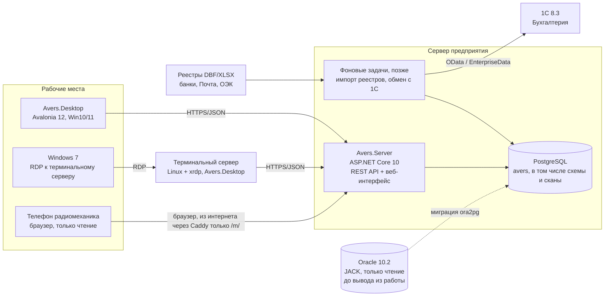

# 03. Архитектура

Статус: действует, сверено с кодом 22.10.2026. Решения с обоснованием — в `docs/adr/`. Что ещё не сделано — в разделе «Дальше».

## Коротко

Модульный монолит на .NET 10 LTS: один сервер приложений (ASP.NET Core) с одной базой PostgreSQL,
к нему подключаются настольное приложение Avalonia 12 на рабочих местах Windows 10/11 и веб-интерфейс
для телефонов радиомехаников. Машины с Windows 7 работают с тем же настольным приложением через
терминальный сервер Linux с xrdp (ADR-0008). Обмен с 1С и загрузка банковских реестров будут жить на сервере.



## Слои и проекты

```
src/
  Avers.Domain/      сущности и правила без базы: абонент, дом, оплата, долг (Billing), заявка, роли, календарь сроков
  Avers.Data/        EF Core (PostgreSQL на сервере, SQLite в учебном режиме), миграции, учебные данные
                     и операции записи с журналом изменений: оплата, договор, тарифы, заявки, ППР, словарь…
  Avers.Contracts/   DTO API, общие для сервера и Desktop
  Avers.Server/      ASP.NET Core 10, Minimal API: вход, права, обработчики по разделам, страница /m/ для телефонов
  Avers.Desktop/     Avalonia 12, MVVM (CommunityToolkit.Mvvm); печать PDF/Word и выгрузки Excel делает сам
tests/
  Avers.Domain.Tests/  Avers.Data.Tests/  Avers.Server.Tests/  Avers.Desktop.Tests/ (Avalonia.Headless)
```

Зависимости идут в одну сторону: `Domain` ← `Data` ← `Server` и `Desktop`; `Contracts` знают только сервер и Desktop.
Операция записи пишется один раз в `Avers.Data` и вызывается и обработчиком сервера, и учебной базой Desktop;
сервер добавляет к ней проверку входных данных и прав. Отдельные слои `Application` и `Infrastructure`
не заводим, пока хватает этого.

`Avers.Desktop` работает через `IAversStore`: `ServerStore` ходит в API сервера (общая база PostgreSQL),
`LocalStore` — в свою учебную SQLite, когда адрес сервера не задан. После входа и после каждой записи программа
получает снимок справочников (`GET /api/desktop/snapshot`: улицы, дома, ППР, заявки — только то, что положено роли).
Абонентов со счетами в снимке нет, они грузятся частями: абоненты дома с оплатами — при выборе дома
(`GET /api/houses/{id}/subscribers`), поиск выполняет сервер (`GET /api/subscribers`), должников и долг по домам
сервер считает по всей базе (`GET /api/debts`, при открытии юристов и отчётов), итоги месяца для 1С —
`GET /api/reports/accounting`. На тестовой базе в 45 000 абонентов и 1,6 млн оплат вход занимает около секунды
вместо 13, программа держит в памяти около 100 МБ вместо 1,1 ГБ. Заявки пока приходят в снимке целиком.

## Ключевые решения

| ADR | Решение |
|---|---|
| [0001](adr/0001-record-architecture-decisions.md) | Решения фиксируем в ADR |
| [0002](adr/0002-target-database-postgresql.md) | Целевая СУБД — PostgreSQL |
| [0003](adr/0003-client-server-architecture.md) | Клиент-сервер: сервер приложений + настольный клиент + веб-интерфейс |
| [0004](adr/0004-dotnet-10-avalonia-12.md) | Перевод оболочки на .NET 10 LTS и Avalonia 12 |
| [0005](adr/0005-migration-approach.md) | Миграция: выгрузка JACK → промежуточная схема → преобразование → сверка, параллельная работа |
| [0006](adr/0006-1c-integration.md) | Обмен с 1С: Аверс — источник начислений и оплат, 1С получает сводные документы |
| [0007](adr/0007-reports-xlsx-pdf.md) | Отчёты: XLSX (ClosedXML) и PDF |
| [0008](adr/0008-windows7-terminal-server.md) | Windows 7 — через терминальный сервер Linux с xrdp |

## Сквозные вопросы

- **Вход.** Учётные записи в таблице пользователей Аверса, пароли — PBKDF2-SHA512. Сервер выдаёт токен на 12 часов
  (ASP.NET Core BearerToken); ключи подписи хранятся в `/var/lib/avers-server/keys`, поэтому вход переживает
  перезапуск сервера. На каждом запросе пользователь перечитывается из базы: отключённый теряет доступ сразу.
  Попытки входа ограничены (10 в минуту с адреса). Сотрудников заводит администратор на экране «Права доступа».
- **Права.** Роли и модули — `RoleCatalog` (Domain), политики сервера — `Avers.Server/Auth/Permissions.cs`.
  Проверка на сервере в каждом обработчике; клиент лишь скрывает кнопки.
- **Журнал изменений.** Таблица журнала (`ChangeLog`): кто, когда, что было и стало. Запись идёт в той же транзакции,
  что и само изменение; править журнал нельзя. Смотрит администратор.
- **Файлы.** Схемы СКПТ и сканы договоров хранятся в PostgreSQL (ADR-0009) и попадают в ночную копию базы.
  Телефону схема отдаётся с водяным знаком.
- **Печать и отчёты.** Делает Desktop на месте: PDF (SkiaSharp), Word (Open XML), Excel (ClosedXML, ADR-0007).
  Данные для них сервер считает по всей базе (`/api/debts`, `/api/reports/accounting`).
- **Обмен с 1С.** Пока файл Excel за месяц (кнопка «Для 1С»); прямая загрузка — позже (ADR-0006).
- **Развёртывание.** Сервер — Ubuntu Server: `deploy/server/install.sh` ставит PostgreSQL, службу systemd на порту 5115
  и ночной `pg_dump` с хранением 30 дней (`docs/09-server.md`). Доступ из интернета — только страница `/m/`
  через Caddy (`avers-internet`). Desktop — самодостаточные сборки win-x64 и linux-x64 из CI; Windows 7 — через xrdp
  (`deploy/xrdp`), запасной вариант на Windows Server — `deploy/rds`.
- **Тесты и CI.** xUnit; серверные тесты идут на SQLite, а в CI ещё и на настоящем PostgreSQL (`AVERS_TEST_POSTGRES`).
  CI собирает, гоняет тесты, проверяет `dotnet format` и пробный запуск программы.

## Технологии

| Слой | Выбор | Почему |
|---|---|---|
| Платформа | .NET 10 LTS (поддержка до 14.11.2028) | .NET 8 снимается с поддержки 10.11.2026 |
| Настольный UI | Avalonia 12 | Оболочка уже на Avalonia; 12-я версия нацелена на .NET 10 |
| MVVM | CommunityToolkit.Mvvm | Простая, генераторы кода, без магии |
| Сервер | ASP.NET Core 10, Minimal API; `/m/` — статическая страница | Одна платформа с клиентом |
| ORM | EF Core 10 + Npgsql | Стандарт для .NET и PostgreSQL |
| СУБД | PostgreSQL (на сервере — версия из Ubuntu 24.04, 16) | Бесплатно, уже есть на предприятии (база SMS) |
| XLSX / PDF / Word | ClosedXML / SkiaSharp / Open XML | См. ADR-0007 |
| Тесты | xUnit, Avalonia.Headless | Серверные тесты и на SQLite, и на PostgreSQL |
| CI | GitHub Actions | Сборка, тесты, формат, сборки для Windows и Linux |

## Дальше

Задумано, но ещё не сделано: перенос данных из JACK (Ora2Pg, `docs/04-db-migration-plan.md`), загрузка банковских
реестров DBF (перенос ImportPay), прямой обмен с 1С по OData, автообновление Desktop (Velopack), журнал работы сервера
в файл (Serilog), шифрование HTTP внутри офиса. Решено 22.10.2026: микросервисы не вводим, остаёмся
модульным монолитом. Загрузку реестров, обмен с 1С и ночные отчёты вынесем в одну фоновую службу рядом с сервером
(отдельная служба systemd, та же база и тот же `Avers.Data`), чтобы долгие задачи не тормозили кассу.
