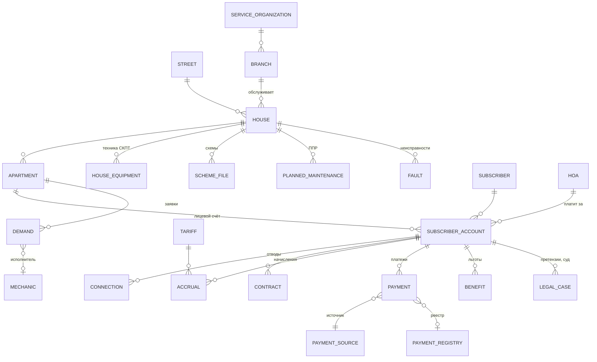

# 04. План миграции базы данных

Статус: черновик, 14.10.2026. Подход — ADR-0005. Исполнитель — агент `db-migration` + администратор Oracle предприятия.

## 0. Принципы

- Боевой Oracle (`servora`, `avers102`) — **только чтение**. Все эксперименты — на копии.
- Каждый шаг — скрипт в `db/migration/`, повторяемый с нуля.
- Каждый перенос заканчивается автоматической сверкой; расхождение = остановка.
- Персональные данные не покидают сеть предприятия и не попадают в git.

## 1. Инвентаризация (нужен доступ к Oracle)

Что получить с боевой базы (делает администратор Oracle или мы — с его разрешения, только чтение):

| Что | Как |
|---|---|
| Версия и кодировка | `select * from v$version; select * from nls_database_parameters;` |
| Список объектов JACK | `db/legacy/01-inventory.sql` |
| Объёмы таблиц | `db/legacy/01-inventory.sql` (num_rows, сегменты); точные числа — `04-row-counts.sql` |
| DDL всей схемы | `db/legacy/03-ddl.sql` (dbms_metadata) и `expdp parfile=db/legacy/expdp-metadata.par` |
| Код PL/SQL | `db/legacy/02-plsql-source.sql` (dba_source) |
| Полная копия данных | `expdp ... SCHEMAS=JACK` в нерабочее время |

Всё, кроме полной копии, запускается одной командой `@00-run-all.sql`; инструкция для администратора —
`db/legacy/README.md`.

Почему так: в документе «существующие решения» таблицы восстановлены по скриншотам и не совпадают с реальными
(`PHYSPERS`, `BUILDING`, `CONNLIST`, `ALL_DEMANDS` …).

## 2. Стенд

Реализован в `db/stand/` (`stand.sh`, описание — `db/stand/README.md`); `stand.sh selftest` прогоняет весь путь
на синтетической схеме.

1. Восстановить выгрузку JACK в Oracle Database Free 23 (контейнер `oracle-legacy` из `db/docker-compose.yml`) —
   `impdp` принимает выгрузки старых версий. Ограничение Oracle Free — 12 ГБ данных; если JACK больше — восстановить на
   сервере предприятия во временную установку или переносить через Ora2Pg с боевой базы (запасной путь).
2. Поднять PostgreSQL 18 (`postgres`), создать схемы `legacy` (зеркало JACK как есть) и `public`/`avers` (новая модель).
3. Ora2Pg 25: `SHOW_REPORT` (оценка сложности), `TABLE`, `SEQUENCE`, `VIEW`, затем `COPY` данных в `legacy`.
   Кодировка: `NLS_LANG=RUSSIAN_RUSSIA.CL8MSWIN1251` на стороне выгрузки, `CLIENT_ENCODING UTF8` на стороне PostgreSQL.
   `PG_NUMERIC_TYPE 0` — деньги остаются `numeric`.

## 3. Разбор и модель

1. Описать каждую таблицу JACK: назначение, ключи, связи, качество данных (`data:explore-data`).
2. Разобрать PL/SQL (`IMPORTPAYFROMBUFF` и др.): что делает, где будет жить в новой системе.
3. Составить таблицу соответствия «старое поле → новое поле» (`db/migration/mapping.md`).
4. Новая модель (черновик):

Старые коды сохраняются полями `legacy_*` (лицевой счёт, внутренний код, индекс ПЖРУ, N_OS/N_KASS/N_OPER/N_КВИТ),
плюс таблица `legacy_id_map(entity, old_id, new_id)` для трассировки.

## 4. Преобразование

SQL-скрипты `legacy → avers` по сущностям, в порядке зависимостей: справочники (улицы, дома, организации, тарифы,
источники оплат, механики) → абоненты и счета → отводы и договоры → начисления и платежи → заявки → льготы → судебные дела.
Нормализация: ФИО (разделить на части, сохранить полное), телефоны, адреса (номер дома с литерой и корпусом: 19Д, 72/1).

## 5. Сверка

| Проверка | Как |
|---|---|
| Число записей | По каждой сущности: legacy vs новая модель |
| Деньги | Сумма платежей по месяцам и источникам; сумма начислений; сальдо на дату по каждому лицевому счёту |
| Бухгалтерия | Отчёты за август 2026 из новой БД против бумажной сверки (ОЭК 4 914 739,57; физлица 5 447 224,99; итого 5 669 697,49) |
| Выборочно | 50 случайных абонентов: карточка в старом Аверсе vs новая система (с сотрудником АДС) |
| Кириллица | Нет `?`/кракозябр в ФИО и адресах |

Первые две строки и кириллица автоматизированы (`db/migration/reconcile/`, запуск — `stand.sh reconcile`):
число строк, число непустых значений, суммы числовых столбцов, диапазоны дат и длины строк по каждой таблице
legacy против Oracle. Эталоны бухгалтерии заведены в `recon.business_check`, запросы к ним — после разбора DDL.

Результат — акт сверки (XLSX), подписывается бухгалтерией.

## 6. Переключение

1. Пробные прогоны на копии — пока сверка не станет чистой.
2. Параллельная работа: старый Аверс основной, новые данные подтягиваются ночью, сотрудники проверяют.
3. День переключения: заморозка ввода в старом Аверсе, финальная выгрузка и перенос, сверка, вход в новую систему.
4. Старый Oracle остаётся в режиме только чтения как архив на оговорённый срок.

## Риски

| Риск | Мера |
|---|---|
| Нет DDL/PL/SQL — логика скрыта | Выгрузка `user_source`, разбор до проектирования |
| Кодировка cp1251 ломает кириллицу | Явные NLS_LANG и проверка после каждого прогона |
| Грязные данные (дубли абонентов, адреса текстом) | Отчёт качества, правила очистки согласовать с АДС |
| JACK больше 12 ГБ (лимит Oracle Free) | Временная установка Oracle на сервере или Ora2Pg с боевой базы |
| Нет драйвера к Oracle 10.2 | Instant Client 11.2/12.1 для Ora2Pg (совместимость проверить на месте) |
