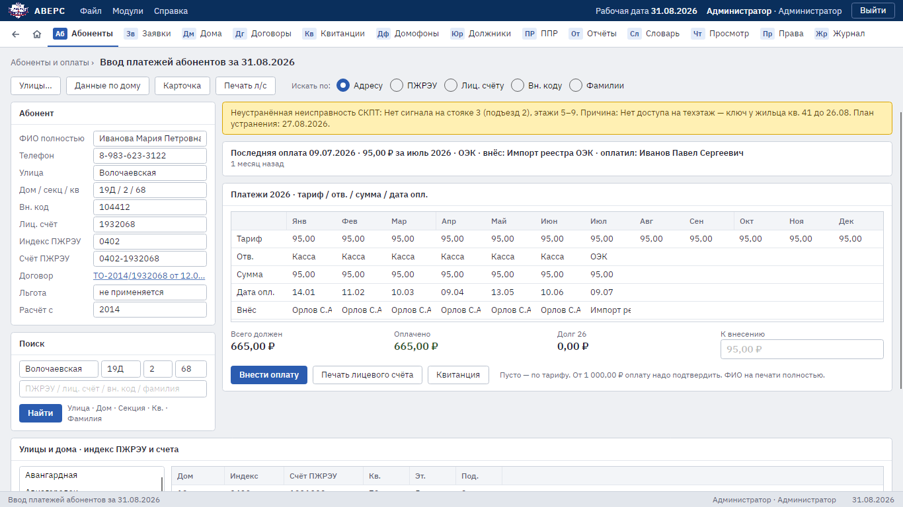
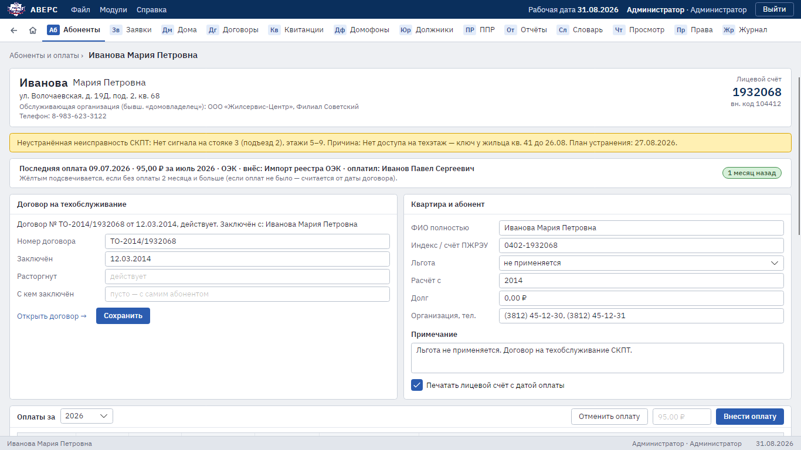

# 1. Абоненты, оплаты и договоры

Для абонентского отдела и начальника АДС. Диспетчеры, юристы и главный инженер видят эти разделы только
для просмотра.

## Найти квартиру

1. Откройте раздел **«Абоненты»**.
2. В строке «Искать по» выберите способ: адрес, счёт ПЖРЭУ, лицевой счёт, внутренний код, фамилия или телефон.
3. Заполните поля в блоке «Поиск» и нажмите **«Найти»**. Фамилия ищется от четырёх букв; короткую фамилию
   (Ли, Ким) вводите целиком. Телефон можно вводить в любой записи: «+7 (983) 623-31-22», «8-983-623-3122»
   или только последние цифры, но не меньше пяти. Удобно, когда жилец звонит и номер виден на телефоне.
4. Можно обойтись без поиска: внизу в списке «Улицы и дома» выберите улицу и дом, справа появятся квартиры дома.

Слева показаны данные абонента, справа — оплаты за год по месяцам, долг и последняя оплата. Если в доме есть
неустранённая неисправность СКПТ, сверху появится жёлтая полоса с её описанием.

### Квартиры, выделенные жёлтым

Жёлтым подсвечены квартиры, где давно не было оплаты: по умолчанию два месяца и больше. Если оплат не было
никогда, срок считается от даты договора. Порог задаётся в карточке квартиры (см. ниже) и действует сразу
на всех рабочих местах.

## Внести оплату

1. Найдите квартиру.
2. В поле **«К внесению»** оставьте пусто, чтобы внести оплату по тарифу, или впишите сумму.
3. Нажмите **«Внести оплату»**.

Оплата ложится в следующий неоплаченный месяц с сегодняшней датой, в графе «Внёс» записывается ваше имя.
Крупную сумму (по умолчанию от 1 000 ₽) программа попросит подтвердить. Внизу окна появится «Внесена оплата
… ₽ за …».

Вносить оплату могут начальник АДС, администратор и сотрудники с отметкой «Может править лицевой счёт».
Остальные увидят «Нет права вносить оплату».

## Карточка квартиры

Кнопка **«Карточка»** или двойной щелчок по квартире. В карточке:

- **лицевой счёт**: оплаты за выбранный год (тариф, сумма, дата, источник, кто внёс, кто оплатил), кнопки
  «Внести оплату» и «Отменить оплату»;
- **договор на техобслуживание**: номер, дата, дата расторжения, с кем заключён (пусто — с самим абонентом);
- **квартира и абонент**: ФИО или название организации, счёт ПЖРЭУ, льгота, обслуживающая организация, примечание;
  отметка **«Юридическое лицо (контрагент)»**: у юрлица появляются поля ИНН, КПП, ОГРН, юридический адрес
  и руководитель;
- **заявки по квартире** за год и кнопка «Принять заявку».

После правки договора, примечания или реквизитов нажмите **«Сохранить»**.

Клиенты бывают физическими и юридическими лицами. Название организации записывается вместо ФИО, как в старой
программе. Реквизиты юрлица можно вносить по мере получения: пустое поле допускается, а заполненное проверяется
(ИНН — 10 цифр, у ИП 12; КПП — 9; ОГРН — 13, у ИП 15). Если снять отметку «Юридическое лицо», реквизиты стираются;
прежние значения остаются в журнале изменений.

**Отменить ошибочную оплату** могут администратор и начальник АДС: выберите оплату и нажмите «Отменить оплату».
Месяц снова станет неоплаченным, а в журнале изменений останется запись со старыми значениями.

### Настройки, общие для всех рабочих мест

Внизу карточки администратор и начальник АДС видят дополнительные блоки:

- **«Подсвечивать жёлтым, если без оплаты … мес.»** — порог жёлтой подсветки;
- **«Подтверждать оплату от … ₽»** — с какой суммы программа просит подтверждение;
- **«Открыть … год»** — начисления на следующий год всем абонентам с действующим договором по последнему тарифу;
- **«Тариф с … »** — новый тариф с указанного месяца для этой квартиры, этого дома или всех абонентов.
  Оплаченные месяцы не меняются.

Каждая настройка применяется кнопкой рядом с ней.

## Договоры

Раздел **«Договоры»** — реестр договоров на обслуживание по дому.

- Выберите улицу и дом; галочка **«Только действующие»** скрывает расторгнутые договоры.
- Поиск по номеру договора или фамилии.
- Двойной щелчок по строке открывает карточку квартиры.
- **«Новая квартира»** заводит абонента с договором; начисления появятся с месяца договора до конца года.
  Повторный лицевой счёт программа не примет.
- **«Новый договор»**, **«Расторгнуть»**, **«Сохранить»** меняют договор выбранной квартиры. После расторжения
  неоплаченные месяцы после месяца расторжения снимаются (сам месяц расторжения начисляется полностью). Если
  заключить новый договор, начисления вернутся.
- **«Бланк договора (Word)»** открывает договор по образцу юристов с уже вписанными номером, датой, ФИО,
  адресом, тарифом и телефоном. Паспорт, ИНН, СНИЛС и дату рождения абонент заполняет от руки.
- **«Реестр в Excel»** выгружает список договоров дома.

## Печать

- **«Печать лицевого счёта»** — лицевой счёт абонента. Галочка в карточке «Печатать лицевой счёт с датой
  оплаты» добавляет даты оплат.
- **«Квитанция»** — квитанция на оплату техобслуживания СКПТ за неоплаченные месяцы.

## Единые квитанции и файл ОЭК

Раздел **«Квитанции»**. Единые квитанции выпускает ОЭК, услуга антенной службы в них идёт под кодом 38.

- Поиск платежей по лицевому счёту, внутреннему коду или индексу ПЖРЭУ за период.
- **«Загрузить файл ОЭК»**: укажите месяц (мм.гггг) и выберите файл начислений ОЭК (`nachММГГГГ_an`, Excel).
  Оплаты лягут в этот месяц с источником «ОЭК». Файл другого месяца программа не примет. Расхождения программа
  откроет в Excel.
