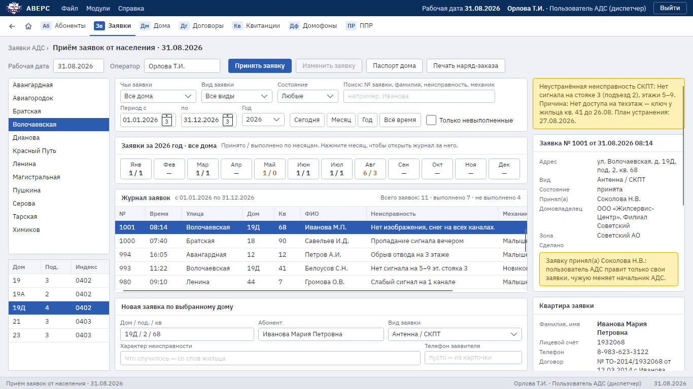

# 2. Заявки АДС

Для диспетчеров и начальника АДС.

## Принять заявку

1. Откройте раздел **«Заявки»**.
2. Выберите дом (и квартиру, если звонит жилец). Справа появятся сведения о доме: антенны, усилители, ключ
   техэтажа, последний ППР, обслуживающая организация с телефонами, последняя оплата квартиры. Если в доме
   есть неустранённая неисправность, программа покажет её сразу.
3. В блоке «Новая заявка» выберите **вид заявки** и **характер неисправности**, опишите, что случилось,
   со слов жильца. Телефон заявителя можно не заполнять: тогда он берётся из карточки.
4. Нажмите **«Принять заявку»**. Внизу окна появится её номер, а заявка встанет в журнал с вашим именем.

Принять заявку можно и из карточки квартиры кнопкой «Принять заявку».

## Журнал заявок

- Период: **«Сегодня»**, **«Месяц»**, **«Год»**, **«Всё время»** или свои даты «с … по …».
- Отбор по дому, подъезду, виду заявки, состоянию и по тому, чьи это заявки.
- **«Только невыполненные»** оставляет открытые заявки.
- Строка поиска ищет по номеру заявки, фамилии, неисправности и механику.
- Сводка «принято / выполнено» по месяцам: щелчок по месяцу открывает журнал за этот месяц.
- **«Паспорт дома»** открывает паспорт дома выбранной заявки.

## Изменить и закрыть заявку

1. Выберите заявку и нажмите **«Изменить заявку»**.
2. Укажите состояние, радиомеханика (из списка в «Словаре»), дату выполнения и что произведено
   (как в наряд-заказе). У отложенной заявки напишите, почему она отложена.
3. Нажмите **«Сохранить»**.

Диспетчер меняет только заявки, которые принял сам; чужие он видит, но не меняет. Начальник АДС и администратор
меняют любые заявки. Все изменения попадают в журнал изменений.

## Наряд-заказ

Кнопка **«Печать наряд-заказа»** открывает PDF по выбранной заявке. Его распечатывают и отдают радиомеханику
на выезд.

## Домофоны

Раздел **«Домофоны»**: выберите улицу и дом.

- **Панели подъездов**: номер подъезда, тип панели, блок коммутации, ключи и ключницы, питание.
  «Новая панель» и «Сохранить панель».
- **Заявки по домофону**: подъезд, неисправность, радиомеханик. «Принять заявку» и «Выполнена».
- **«Печать»** — панели подъездов и невыполненные заявки дома в PDF.
