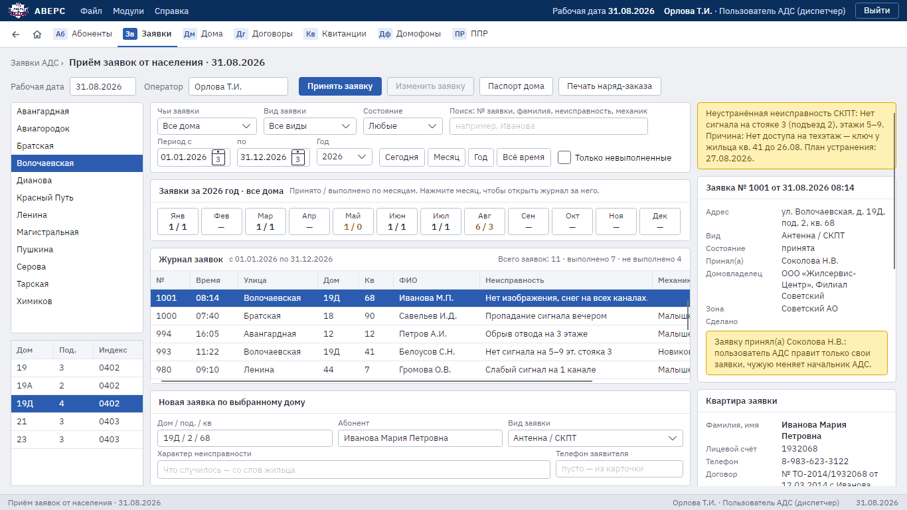

# 2. Заявки АДС

При повторном звонке выберите дом и квартиру и нажмите **«Проверить открытые заявки»** в форме приёма.
Заявки выбранной квартиры идут первыми. Нажмите строку, чтобы открыть существующую заявку.

Для диспетчеров и начальника АДС.

## Принять заявку

1. Откройте раздел **«Заявки»**.
2. Нажмите **«Новая заявка»** над журналом. Выберите улицу и дом, укажите подъезд и квартиру.
   При переходе от абонента его адрес и телефон подставляются видимо; их можно уточнить для этого обращения.
   Для общедомовой неисправности квартиру можно оставить пустой.
3. Выберите **вид заявки**, обязательно опишите неисправность, укажите телефон и ответственного механика.
   Механика можно назначить позднее. Сведения о доме раскрываются в форме; существующая неисправность
   с причиной и планом устранения показывается предупреждением.
4. Нажмите **«Принять заявку»**. Внизу окна появится её номер, а заявка встанет в журнал с вашим именем.

Принять заявку можно и из карточки квартиры кнопкой «Принять заявку».

## Журнал заявок

- Период: **«Сегодня»**, **«Месяц»**, **«Год»**, **«Всё время»** или свои даты «с … по …».
- Отбор по дому, подъезду, виду заявки, состоянию и по тому, чьи это заявки.
- **«Только невыполненные»** оставляет открытые заявки.
- **«Только просроченные»** оставляет заявки, у которых прошёл срок.
- Строка поиска ищет по номеру заявки, фамилии, неисправности и механику.
- В журнале показывается не больше 1000 заявок, самые свежие. Если внизу окна появилось «Показаны последние
  1000 заявок», сузьте период или выберите дом.
- Сводка «принято / выполнено» по месяцам: щелчок по месяцу открывает журнал за этот месяц.
- **«Паспорт дома»** открывает паспорт дома выбранной заявки.

## Срок выполнения

Срок заявки — 3 дня от дня приёма; он виден в форме приёма и отдельной карточке заявки. Если срок прошёл, а заявка принята или
в работе, она просрочена: строка в журнале красная, в карточке написано «просрочена», в итогах над журналом —
сколько таких заявок. Отложенная заявка просроченной не считается: её откладывают с причиной.

## Список для ОЭК

Раскройте **«Сводка по месяцам и выгрузка для ОЭК»** над журналом. Выберите день и нажмите **«Выгрузить в Excel»**: в файл попадут все заявки,
принятые в этот день, с адресом, неисправностью, тем, что сделано, датой выполнения и механиком. Если за день
выполнены не все заявки, список не выводится — программа напишет, сколько принято и сколько выполнено.

## Изменить и закрыть заявку

1. Выберите строку журнала и нажмите **«Открыть заявку»**, Enter или дважды щёлкните по строке.
   Откроется отдельная карточка выбранного обращения, включая блок **«Абонент этой заявки»**.
2. Укажите состояние, радиомеханика (из списка в «Словаре»), дату выполнения и что произведено
   (как в наряд-заказе). У отложенной заявки напишите, почему она отложена.
3. Нажмите **«Сохранить»**.

Диспетчер меняет только заявки, которые принял сам; чужие он видит, но не меняет. Начальник АДС и администратор
меняют любые заявки. Все изменения попадают в журнал изменений.

Возврат из карточки сохраняет отбор журнала. Если сохранённая заявка перестала подходить под отбор,
она не остаётся скрыто выбранной. При уходе с правками программа предлагает сохранить, отменить или остаться.
Черновик новой заявки при таком переходе можно отменить или продолжить заполнять; автоматического приёма нет.

## Наряд-заказ

Кнопка **«Печать наряд-заказа»** открывает PDF по выбранной заявке. Его распечатывают и отдают радиомеханику
на выезд.

## Домофоны

Раздел **«Домофоны»**: выберите улицу и дом.

- **Панели подъездов**: номер подъезда, тип панели, блок коммутации, ключи и ключницы, питание.
  Если панелей нет, нажмите **«Добавить панель»**. Заполните черновик и нажмите **«Сохранить панель»**.
  При уходе или смене дома правки можно сохранить, отменить или продолжить.
- **Заявки по домофону**: подъезд, неисправность, радиомеханик. «Принять заявку» и «Закрыть выбранную».
  По умолчанию видны открытые заявки; **«Показать выполненные»** добавляет выполненные обращения.
  Закрыть можно только выбранную открытую заявку.
- **«Печать»** — панели подъездов и невыполненные заявки дома в PDF.

Этот технический раздел не заменяет отдельный абонентский и расчётный учёт старого «Домофона».
Оплаты и тарифы двух услуг не объединяются автоматически.
