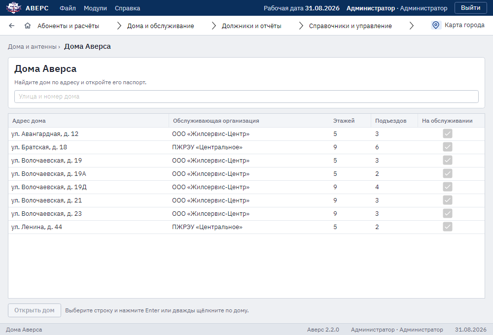
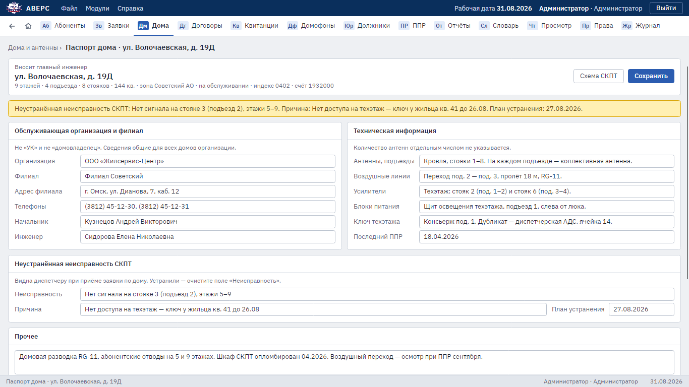
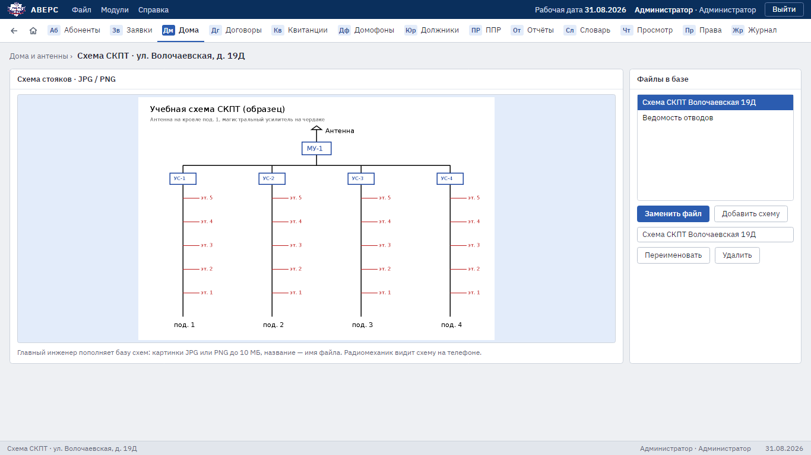
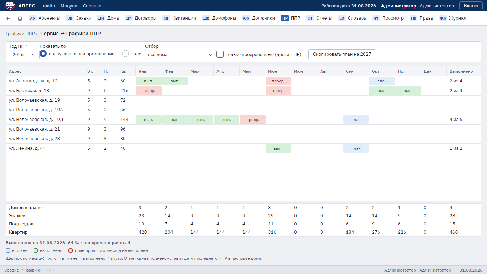

# 3. Дома, схемы СКПТ, графики ППР, словарь

Для главного инженера и администратора. Остальные сотрудники с доступом к разделу просматривают сведения.

## Паспорт дома

Если после открытия паспорта другой сотрудник изменил дом или обслуживающую организацию, сохранение
сообщит о конфликте. Обновите сведения и повторите свои правки: изменения коллеги не перезаписываются.
Та же проверка действует при сохранении и удалении дома или организации в «Словаре».

Откройте **«Дома и обслуживание» → «Дома и антенны»**. Сначала показан реестр домов Аверса.
Строка над списком ищет по частям адреса. Выберите дом и нажмите **«Открыть дом»**, Enter
или дважды щёлкните строку. Только после выбора откроется паспорт.

**«К списку домов»** возвращает в реестр. При переходе из абонента кнопкой **«Дом абонента»**
его паспорт открывается сразу; **«Назад»** возвращает к тому же абоненту.
Реестр содержит дома системы Аверса, а городской справочник адресов открывается отдельно на карте.

Главный инженер заполняет:

- **обслуживающую организацию и филиал** (ЖЭУ, ТСЖ): адрес, телефоны, начальник, инженер. Эти сведения общие
  для всех домов организации;
- **техническую информацию**: антенны и подъезды, воздушные линии, усилители, блоки питания, ключ техэтажа;
- **неустранённую неисправность СКПТ**: что не работает, причина, план устранения. Её видит диспетчер при приёме
  заявки по дому. Просроченный план устранения выделяется красным. Когда неисправность устранили, очистите поле.

После правки нажмите **«Сохранить»**. Внизу паспорта видны заявки по дому и что по ним сделано.

При уходе с несохранёнными правками паспорта или обслуживающей организации программа предлагает
сохранить их, отменить изменения или остаться. При отмене восстанавливаются и сведения организации,
общие для нескольких домов. Сотрудники с правом просмотра видят поля паспорта без возможности изменения.

## Схемы СКПТ

1. В паспорте дома нажмите **«Схема СКПТ»**.
2. **«Добавить схему»**: картинка JPG или PNG до 10 МБ, название берётся из имени файла.
3. Для выбранной схемы есть **«Переименовать»**, **«Заменить файл»** и **«Удалить»**.

Схемы хранятся в базе. Загруженную схему радиомеханик сразу видит на телефоне.

## Графики ППР

1. Раздел **«ППР»**, выберите год.
2. Щелчок по клетке месяца меняет отметку по кругу: пусто → в плане → выполнено → пусто.
3. Отметка «выполнено» ставит дату последнего ППР в паспорте дома.
4. Невыполненный план прошлого месяца выделен цветом. Галочка **«Только просроченные (долги ППР)»** оставляет
   только такие дома.
5. Показать можно по обслуживающей организации или по зоне. Внизу итоги по месяцам и процент выполнения.
6. Кнопка **«Скопировать план на …»** переносит план года на следующий год.

## Словарь

Раздел **«Словарь»** — справочники, которыми пользуются все разделы:

- **улицы и дома**: индекс и счёт ПЖРЭУ, этажи, подъезды, стояки, квартиры, зона, обслуживающая организация,
  отметка «На обслуживании»;
- **обслуживающие организации**: название, филиал, адрес, телефоны, начальник и инженер;
- **материалы** с единицами измерения;
- **радиомеханики**: ФИО, должность, телефон, адрес. Из этого списка диспетчер выбирает исполнителя заявки.

Кнопку «Удалить» нажимают дважды. Улицу с домами, организацию с домами и дом с абонентами, заявками или схемами
удалить нельзя: такой дом снимают с обслуживания.
Если связанные записи добавили одновременно с удалением, база также отклонит удаление: обновите словарь.
