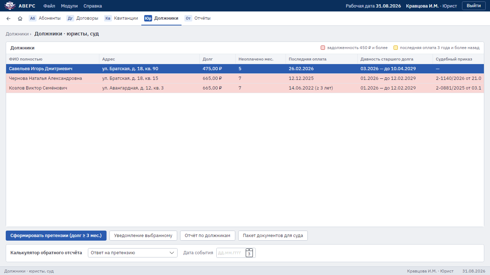

# 4. Должники и судебные дела

Для юристов.

## Список должников

Раздел **«Должники»**. В таблице ФИО полностью, адрес, долг, сколько месяцев не оплачено, последняя оплата,
давность старшего долга и судебный приказ (номер и дата), если дело уже заведено.

Цветом выделены:

- задолженность 450 ₽ и более;
- последняя оплата три года назад и раньше (подходит срок исковой давности), такие строки помечены «≥ 3 лет».

Долг считается по месяцам до текущего, как в старой программе: текущий месяц ещё не долг, но в квитанцию
на оплату он попадает. Срок давности за каждый месяц отсчитывается от 10 числа следующего месяца — это срок
оплаты по договору.

Над списком — отбор. Пустое поле не учитывается.

Кнопка **«Обновить»** перечитывает текущую страницу с сохранением отбора — например, после работы другого сотрудника.

- **Долг от, ₽** и **неоплачено от, мес.** — оставляют тех, у кого долг или число неоплаченных месяцев не меньше;
- **Адрес** — слова из адреса, например «Ленина 12»;
- **Судебный приказ** — любые, только те, по кому приказ есть, или только те, по кому его нет;
- **Клиенты** — все, только физические или только юридические лица (контрагенты). Кто есть кто, видно
  в столбце «Клиент».

Тип клиента и реквизиты задаются в **карточке абонента**: отметка **«Юридическое лицо (контрагент)»**,
ИНН, КПП, ОГРН, юридический адрес и руководитель. Изменения сохраняет сотрудник с правом правки карточки.
В списке должников поле «Клиенты» только отбирает записи по этому сохранённому признаку.

Список показан страницами по 100 строк. Над таблицей видны номера строк и общее число по выбранному отбору.
Кнопки «Назад» и «Далее» переключают страницы. Во время загрузки подождите появления нового списка.
Отчёт и массовые претензии включают весь выбранный отбор, включая строки с остальных страниц.

Кнопки над списком:

- **«Претензии физлицам (долг ≥ 3 мес.)»** — уведомления показанным должникам-физлицам без судебного приказа одним файлом
  Word, каждое с новой страницы;
- **«Уведомление выбранному»** — уведомление одному должнику: выбор варианта текста, правка и печать в Word;
- **«Отчёт по должникам»** — показанный список в Excel;
- **«Пакет документов для суда»** — экран работы с выбранным должником (см. ниже).

## Пакет документов для суда

На этом экране собрано всё по одному должнику:

- **досудебное уведомление** по образцу юристов: адрес, сумму и дату отключения программа подставляет сама,
  окончательно текст правится в Word;
- **комплект в ZIP**: `расчёт.pdf` со справкой о задолженности и историей платежей (лицевой счёт за каждый год),
  договорные сканы в исходном формате и `Состав.txt` с перечнем вложений. Отметка «Включить все сканы договора»
  добавляет все договорные сканы выбранного абонента; решения суда и постановления ОСП автоматически не добавляются.
  Если скана нет, это отмечается в перечне;
- **расчёт неустойки** на выбранную дату;
- **заявление на судебный приказ** и **заявление в ОСП** в Word.

Для **юрлица** формируется расчётный комплект организации: справка, история платежей, имеющиеся реквизиты
и сканы договора. Юридический адрес указывается отдельно от адреса обслуживания. Согласованных юридических
шаблонов для организаций пока нет, поэтому формы физлица не применяются. Неустойка для юрлица не рассчитывается:
ставка и условия его договора не заданы. Перед подачей состав комплекта проверяет юрист.

### Судебное дело

Блок «Судебное дело (последнее)»: номер приказа и дата, сумма, суд, состояние, госпошлина, куда направлен
исполнительный лист (ОСП или ОСФР) и когда, поступления по делу (в виде `901,58-28.11.24 + 214,93-24.12.24`)
и примечание. Кнопки **«Новое дело»** и **«Сохранить дело»** видны только юристам, каждое изменение
записывается в журнал изменений.

### Сканы документов

Сканы договора, решения суда, постановления ОСП: **«Добавить скан»** (PDF, JPG или PNG до 20 МБ),
**«Открыть»**, **«Удалить скан»**.
Договорные сканы также доступны в разделе **«Договоры»**, в блоке «Сканы бумажного договора».

## Калькулятор сроков

Блок **«Калькулятор обратного отсчёта»**: укажите дату события, и программа покажет последний день и сколько
дней осталось по каждому сроку.
При выборе срока сразу показаны его длительность и пояснение; без даты программа просит указать исходное событие.
Калькулятор справочный: выбор срока не меняет список должников и сведения судебного дела.

| Срок | Длительность |
|---|---|
| Ответ на претензию | 30 дней |
| Возражения на судебный приказ | 10 дней |
| Обжалование решения суда | 1 месяц |
| Срок исковой давности | 3 года |
| Повторное направление в ОСП | 6 месяцев |

Срок считается со следующего дня после события (ГК РФ, ст. 191–193). Если последний день выпадает на выходной
или праздник, он переносится на ближайший рабочий день с учётом переносов выходных по постановлениям
правительства на 2025–2027 годы. Для более поздних лет программа предупредит, что переносы ещё не внесены:
проверьте дату по производственному календарю.
