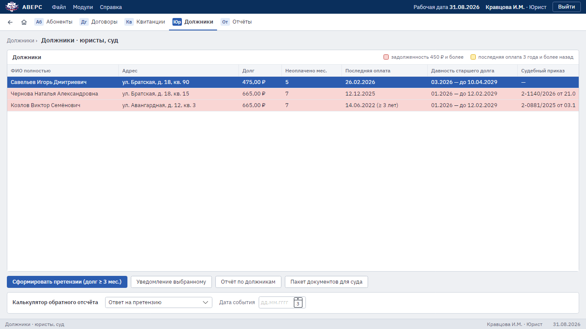

# 4. Должники и судебные дела

Для юристов.

## Список должников

Раздел **«Должники»**. В таблице ФИО полностью, адрес, долг, сколько месяцев не оплачено, последняя оплата,
давность старшего долга и судебный приказ (номер и дата), если дело уже заведено.

Цветом выделены:

- задолженность 450 ₽ и более;
- последняя оплата три года назад и раньше (подходит срок исковой давности), такие строки помечены «≥ 3 лет».

Долг считается по месяцам до текущего, как в старой программе: текущий месяц ещё не долг, но в квитанцию
на оплату он попадает. Срок давности за каждый месяц отсчитывается от 10 числа следующего месяца — это срок
оплаты по договору.

Над списком — отбор. Пустое поле не учитывается.

- **Долг от, ₽** и **неоплачено от, мес.** — оставляют тех, у кого долг или число неоплаченных месяцев не меньше;
- **Адрес** — слова из адреса, например «Ленина 12»;
- **Судебный приказ** — любые, только те, по кому приказ есть, или только те, по кому его нет.

Над таблицей видно, сколько должников показано из всех. Отчёт и претензии формируются по тем, кто показан.

Кнопки над списком:

- **«Сформировать претензии (долг ≥ 3 мес.)»** — уведомления всем показанным должникам без судебного приказа одним файлом
  Word, каждое с новой страницы;
- **«Уведомление выбранному»** — уведомление одному должнику: выбор варианта текста, правка и печать в Word;
- **«Отчёт по должникам»** — показанный список в Excel;
- **«Пакет документов для суда»** — экран работы с выбранным должником (см. ниже).

## Пакет документов для суда

На этом экране собрано всё по одному должнику:

- **досудебное уведомление** по образцу юристов: адрес, сумму и дату отключения программа подставляет сама,
  окончательно текст правится в Word;
- **пакет в PDF**: справка о задолженности и история платежей (лицевой счёт за каждый год). Копию договора
  приложите из бумажного архива;
- **расчёт неустойки** на выбранную дату;
- **заявление на судебный приказ** и **заявление в ОСП** в Word.

### Судебное дело

Блок «Судебное дело (последнее)»: номер приказа и дата, сумма, суд, состояние, госпошлина, куда направлен
исполнительный лист (ОСП или ОСФР) и когда, поступления по делу (в виде `901,58-28.11.24 + 214,93-24.12.24`)
и примечание. Кнопки **«Новое дело»** и **«Сохранить дело»** видны только юристам, каждое изменение
записывается в журнал изменений.

### Сканы документов

Сканы договора, решения суда, постановления ОСП: **«Добавить скан»** (PDF, JPG или PNG до 20 МБ),
**«Открыть»**, **«Удалить скан»**.

## Калькулятор сроков

Блок **«Калькулятор обратного отсчёта»**: укажите дату события, и программа покажет последний день и сколько
дней осталось по каждому сроку.

| Срок | Длительность |
|---|---|
| Ответ на претензию | 30 дней |
| Возражения на судебный приказ | 10 дней |
| Обжалование решения суда | 1 месяц |
| Срок исковой давности | 3 года |
| Повторное направление в ОСП | 6 месяцев |

Срок считается со следующего дня после события (ГК РФ, ст. 191–193). Если последний день выпадает на выходной
или праздник, он переносится на ближайший рабочий день с учётом переносов выходных по постановлениям
правительства на 2025–2027 годы. Для более поздних лет программа предупредит, что переносы ещё не внесены:
проверьте дату по производственному календарю.
