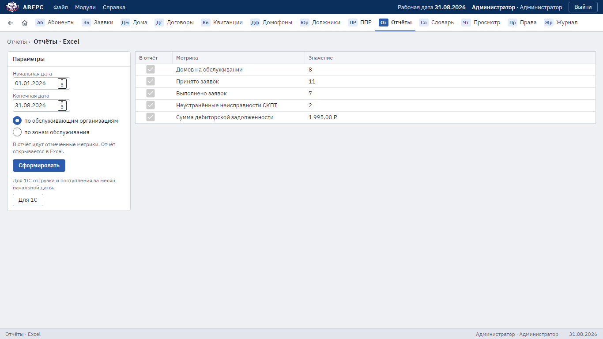

# 5. Отчёты и выгрузка для 1С

Раздел **«Отчёты»**.

## Отчёт по заявкам и домам

1. Укажите **начальную** и **конечную** дату.
2. Выберите разбивку: **по обслуживающим организациям** или **по зонам обслуживания**.
3. Отметьте нужные метрики:
   - домов на обслуживании;
   - принято заявок;
   - выполнено заявок;
   - неустранённые неисправности СКПТ;
   - сумма дебиторской задолженности.
4. Нажмите **«Сформировать»**. Отчёт откроется в Excel со строкой «Итого».

## Для 1С

Кнопка **«Для 1С»** (её видят администратор и начальник АДС) выгружает в Excel итоги за месяц начальной даты
в двух разделах:

- **Отгрузка** — начисления по тарифам (количество × цена) для документа «Реализация» в 1С;
- **Поступления** — деньги по источникам (ОЭК, касса, банки) по фактической дате оплаты.

Пока бухгалтер переносит эти суммы в 1С вручную или загрузкой из Excel. Разбивка на физических лиц, юридических
лиц и ТСЖ появится после ответа бухгалтерии, как их различать.

## Должники в Excel

Список должников выгружается кнопкой «Отчёт по должникам» в разделе «Должники», см.
[4. Должники и судебные дела](04-debtors.md).
