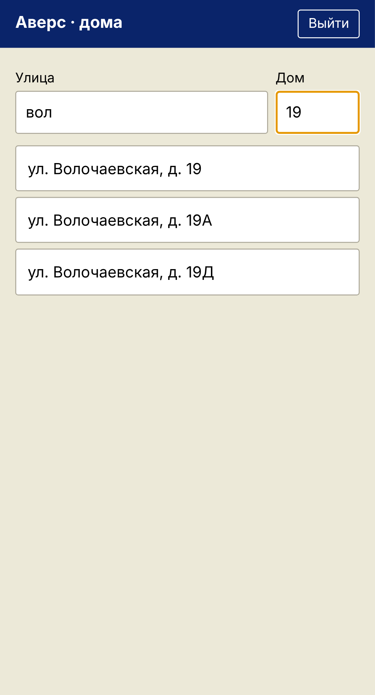
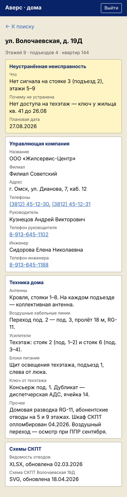

# 6. Телефон радиомеханика

Страница для телефона показывает сведения о доме на выезде. Устанавливать ничего не нужно, достаточно браузера.

| Поиск дома | Карточка дома |
|---|---|
|  |  |

1. Откройте в браузере телефона адрес, который выдал администратор (заканчивается на `/m/`).
2. Войдите своим логином и паролем.
3. Введите улицу и номер дома.
4. На экране: обслуживающая организация с телефонами (нажатие на номер звонит), оборудование дома, ключ
   техэтажа, открытая неисправность и схемы СКПТ.
5. Нажмите на схему, чтобы открыть её. Повторное нажатие переключает «по ширине экрана» и «в натуральную
   величину».

Чтобы открывать страницу как приложение, в меню браузера выберите **«Добавить на главный экран»**.

Изменить на странице ничего нельзя. На схеме стоит водяной знак с вашим логином и датой.

В программе на компьютере у радиомеханика есть раздел **«Просмотр»** с теми же сведениями.
