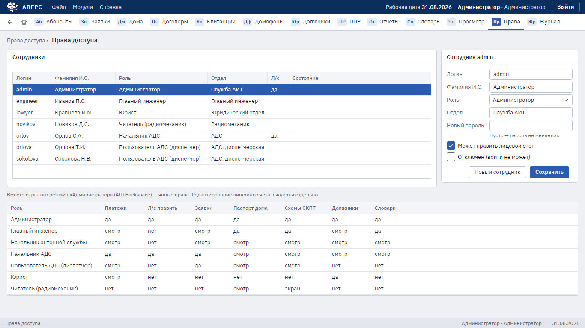
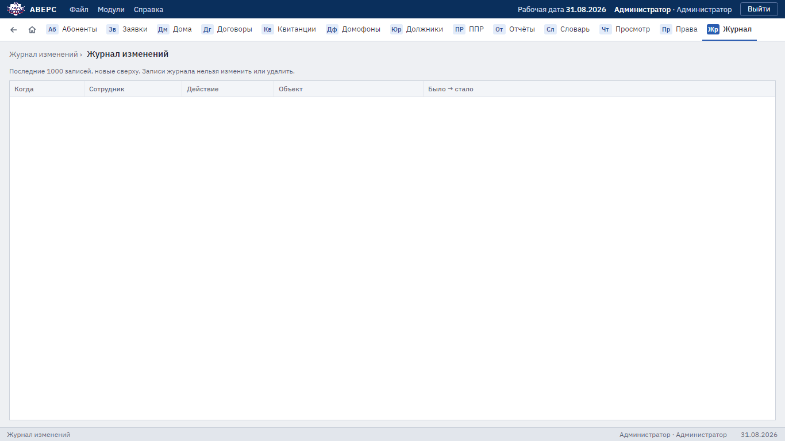

# 7. Сотрудники и журналы

Только для администратора. Установка и обслуживание сервера описаны отдельно:
[сервер Аверса](../09-server.md) и [терминальный сервер для Windows 7 и 8](../08-terminal-server.md).

## Права доступа

Раздел **«Права»**.

- **«Новый сотрудник»**: логин, Фамилия И.О., роль, отдел, пароль не короче шести символов, затем **«Сохранить»**.
- Отметка **«Может править лицевой счёт»** даёт право вносить оплаты и править карточку абонента независимо
  от роли.
- **«Отключён (войти не может)»** используется вместо удаления: история действий сотрудника сохраняется.
- Чтобы сменить пароль, впишите его в поле «Новый пароль» и нажмите «Сохранить». Сотрудник, который в этот
  момент работает в программе, будет отключён и войдёт уже с новым паролем.
- Себя отключить или снять с себя роль администратора нельзя: это защита от случайной блокировки.
- Внизу экрана таблица: что может каждая роль.

Отключение и смена роли действуют сразу.

На сервере пароль можно сменить и из командной строки: `sudo avers-password <логин>`
(см. [сервер Аверса](../09-server.md)).

## Журнал изменений

Раздел **«Журнал»**, вкладка **«Изменения»**: когда, кто, что сделал и с каким объектом, «было → стало».
В журнал попадают оплаты и их отмена, договоры и карточки абонентов, паспорта домов, словарь, схемы СКПТ,
домофоны, заявки, отметки ППР, общие настройки, судебные дела и изменения сотрудников (пароль записывается
только как «изменён»).

Вкладка **«Просмотры данных абонентов»**: кто и когда открывал карточки, оплаты, список должников и сканы
документов. Этот журнал нужен для защиты персональных данных (152-ФЗ).

Показываются последние 1000 записей. Удалить или изменить запись нельзя.
