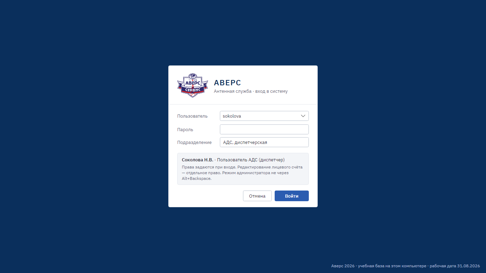
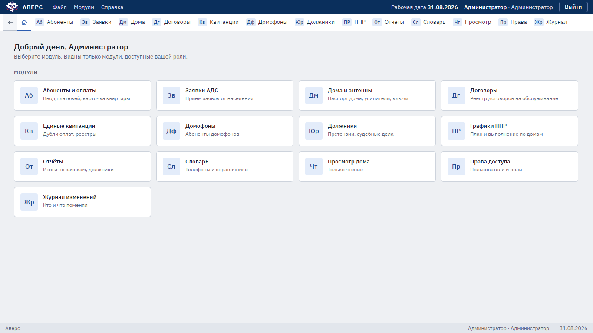

# Руководство пользователя

Руководство для сотрудников, которые работают в «Аверсе». Сначала прочитайте раздел «Общее для всех» на этой
странице, затем раздел своей должности.

| Раздел | Для кого |
|---|---|
| [1. Абоненты, оплаты и договоры](01-subscribers.md) | Абонентский отдел, начальник АДС |
| [2. Заявки АДС](02-tickets.md) | Диспетчеры, начальник АДС |
| [3. Дома, схемы СКПТ, графики ППР, словарь](03-houses.md) | Главный инженер |
| [4. Должники и судебные дела](04-debtors.md) | Юристы |
| [5. Отчёты и выгрузка для 1С](05-reports.md) | Руководство, бухгалтерия, юристы |
| [6. Телефон радиомеханика](06-mobile.md) | Радиомеханики |
| [7. Сотрудники и журналы](07-administration.md) | Администратор |

## Общее для всех

### Вход

Введите свой логин и пароль и нажмите «Войти». Логин и первый пароль выдаёт администратор. Каждый сотрудник
входит под своим именем: от этого зависит, какие разделы ему доступны, и под этим именем программа записывает
его действия в журнал.

После нескольких неверных паролей подряд вход под этим логином временно блокируется. Подождите несколько минут
или попросите администратора сменить пароль.

### Рабочий стол

На рабочем столе плитки разделов, доступных вашей должности. Чужих разделов в списке нет, так и задумано.
Те же разделы есть в строке под заголовком окна и в меню «Модули». Стрелка «←» возвращает на предыдущий экран,
значок домика — на рабочий стол.

В правом верхнем углу видны рабочая дата, ваше имя и должность. Кнопка «Выйти» и пункт меню
«Файл → Сменить пользователя» завершают работу под вашим именем.

### Строка состояния

Внизу окна программа пишет результат каждого действия: «Внесена оплата…», «Принята заявка № …», «Нет права…».
Если кажется, что кнопка ничего не сделала, посмотрите туда.

### Печать и отчёты

Печатные формы (квитанции, лицевые счета, наряд-заказы, справки для суда) открываются в PDF, печатайте их
из программы просмотра PDF. Заявления и договоры открываются в Word, отчёты и реестры — в Excel.

### Если программа просит обновиться

Сообщение «Обновите программу» означает, что на сервере стоит более новая версия. Работать в старой версии
сервер не даёт, чтобы не испортить данные. Обратитесь к администратору.

## Права по должностям

| Должность | Что правит | Что только смотрит |
|---|---|---|
| Администратор | Всё, включая сотрудников и настройки | — |
| Начальник АДС | Абоненты и оплаты, все заявки, настройки подсветки и подтверждения оплат | Дома, схемы, должники |
| Пользователь АДС (диспетчер) | Свои заявки | Абоненты, дома, схемы, чужие заявки |
| Главный инженер | Паспорта домов, схемы СКПТ, графики ППР, словарь | Абоненты, заявки, должники |
| Начальник антенной службы | — | Абоненты, заявки, дома, схемы, должники, словарь |
| Юрист | Должники, судебные дела, документы для суда | Абоненты |
| Читатель (радиомеханик) | — | Просмотр дома и схем, страница для телефона |

Вносить оплаты и править карточку абонента может также сотрудник с отметкой «Может править лицевой счёт».
Точную таблицу прав показывает раздел «Права доступа» у администратора.

## Учебный режим

Для обучения программа запускается с учебной базой: вымышленные абоненты, дома и заявки Омска, рабочая дата
31.08.2026. Как её запустить, описано в [docs/getting-started.md](../getting-started.md). Учебные пользователи
(пароль у всех `avers`):

| Логин | Сотрудник | Должность |
|---|---|---|
| `admin` | Администратор | Администратор |
| `orlov` | Орлов С.А. | Начальник АДС |
| `sokolova`, `orlova` | Соколова Н.В., Орлова Т.И. | Пользователь АДС (диспетчер) |
| `engineer` | Иванов П.С. | Главный инженер |
| `lawyer` | Кравцова И.М. | Юрист |
| `novikov` | Новиков Д.С. | Читатель (радиомеханик) |

Зайдите под каждым по очереди: так видно, какие разделы получает каждая должность.
